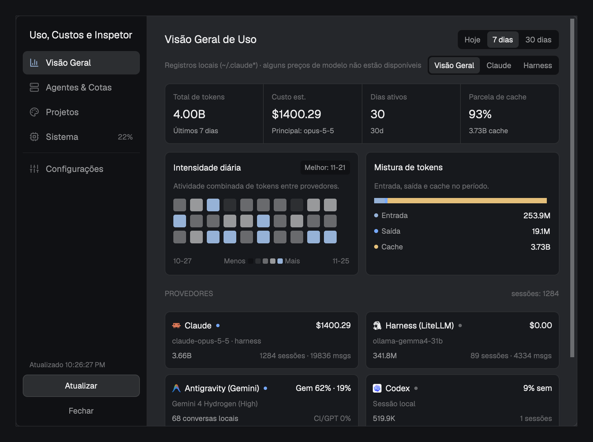

# Herdr Usage Meter (`usage-meter`)

Orca-style bottom status bar, quick usage popover, and native dialog inspector mod for [Herdr](https://herdr.dev).



## Features

- **Unified Bottom Status Bar (`28px`):** Compact pills for Claude (multiple profiles supported), Harness/LiteLLM gateways, Antigravity (Gemini + Claude/GPT), Codex, OpenCode, and system CPU/RAM. Always starts collapsed by default and can expand/collapse with one click.
- **Quick Popover with Drill-down:** Switch between `Detailed` and `Compact` modes, toggle `Used` vs `Left` percentages, and click providers to drill into 5h/weekly quota breakdowns.
- **Usage Overview & Inspector (`840×616`):**
  - 35-day activity intensity heatmap and token mix visualization (`Input`, `Output`, `Cache read`, `Cache write`).
  - Dynamic `Providers` grid (`Claude`, `Harness`, `Antigravity (Gemini)`, `Codex`, `OpenCode`, and extra detected CLIs).
  - 14-day daily chart, top models, top local projects, live system resources & listening ports (`lsof`).
- **Multi-Account & Granular Customization:**
  - Inline profile renaming (`Alias`), 17-icon picker, per-account `In bar` / `Active` toggles.
  - Granular bar visibility controls (`showCostInSidebar`, `showEstimatedCost`, `showCostInPopover`, `showCpuInBar`, `showPortsInBar`, `showBarActions`, `alwaysStartCollapsed`).
  - Multi-language UI: **Auto**, **Português**, **English**, and **Español**.

## Installation

1. Copy `mods/usage-meter` into your Herdr config directory:

   ```bash
   cp -R mods/usage-meter ~/.config/herdr-app/mods/usage-meter
   ```

2. Validate the mod:

   ```bash
   herdr-app check ~/.config/herdr-app/mods/usage-meter
   ```

3. Add the `status` block to your layout (or check out [`herdr-main-orca`](https://github.com/goul4rt/herdr-main-orca) for the complete layout):

   ```json
   {
     "id": "status",
     "type": "block",
     "content": {
       "mod": "usage-meter",
       "props": {
         "mode": "status",
         "poller": true
       }
     },
     "size": {
       "px": 28
     }
   }
   ```

4. *(Optional)* Merge `keys.json` shortcuts (`alt-u` for popover, `alt-shift-u` for overview dialog) into `~/.config/herdr-app/keys.json`.

## Available Commands

Triggerable via `keys.json` or `herdr-app do`:

- `usage-meter.popover` — Toggle quick usage popover
- `usage-meter.details` — Open Overview dialog
- `usage-meter.claude` / `usage-meter.all` — Open Overview on Claude / All providers
- `usage-meter.agents` / `usage-meter.ports` / `usage-meter.settings` — Open specific inspector tabs
- `usage-meter.refresh` — Trigger immediate usage & quota refresh
- `usage-meter.toggle_bar` — Collapse/expand the bottom bar

## Requirements & Privacy

- **macOS** (`python3`, `curl`, Keychain `security`, `lsof`, `vm_stat`, `top`)
- All log parsing and token/cost aggregation runs **locally** on your machine (`~/.claude*`, `~/.gemini/`, `~/.codex/`, etc.). Quota checks talk directly to the provider endpoints already authenticated in your CLI/Keychain.

## License

MIT
