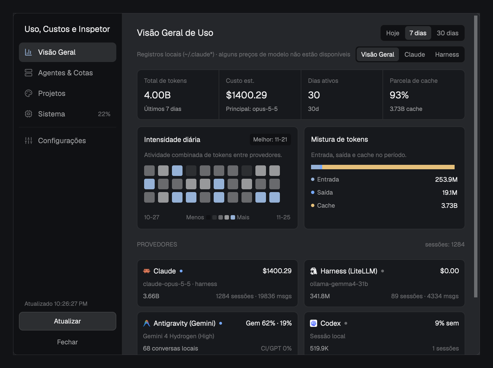

# Usage Meter

An Orca-inspired unified AI agent usage, quota, local cost, and macOS system meter for Herdr: lives quietly in a 28px bottom status bar (or collapsible strip), opens a compact drill-down popover above the footer, and launches an 840x616 native dialog inspector covering multi-account Claude profiles, LiteLLM/Gateway harnesses, Antigravity (Gemini + Claude/GPT), Codex, OpenCode, other detected CLIs, local project token totals, listening ports, and per-account customization in Portuguese, English, and Spanish.

## What you see

- **Bottom status bar (`mode: "status"`, 28px slot height):** Left summary shows live machine/agent counts (`{machine} • {n} agents`), optional `Used`/`Left` toggle chip, compact provider pills (`Claude` with icon, 5h %, weekly %, optional Fable %), any extra pinned profiles (e.g. LiteLLM/Gateway harness or Team account), and `Antigravity` (`Gem X%/Y% · Cl Z%`). Right side holds optional CPU badge, optional `$USD` today pill, optional settings/refresh icons, a collapse chevron (`«` / `»`), and the Herdr command palette hint.
- **Quick popover (`400px` wide overlay triggered from the bar):** Header with agent title, refresh button, and `Used ↑↓` / `Left ↓↑` sort toggle; `Detailed | Compact` segmented mode switch; expandable rows for each enabled Claude/Harness account and Antigravity (`>`) that drill down in-place into full window bars (`5h`, `Weekly`, model breakdowns); optional estimated API cost footer; and action rows for `Usage Details & History`, `Ports & System Resources`, and `Accounts & Settings...`.
- **Inspector dialog (`840x616` overlay with `190px` left navigation rail):**
  - **Overview:** Timeframe (`Today` / `7 days` / `30 days`) and scope (`Overview` / `Claude` / `Harness`) switches; unified 4-cell KPI strip(s) (`Total tokens`, `Est. cost`, `Active days`, `Cache share`; or `Input`, `Output`, `Cache read`, `Cache write`, `Cache reuse`, `No cache read`, `Sessions / Turns`, `Est. cost`); 35-day activity intensity heatmap; stacked token mix bar; 2-column `PROVIDERS` grid covering `Claude`, `Harness (LiteLLM)`, `Antigravity (Gemini)`, `Codex`, `OpenCode`, and other detected agents; 14-day stacked daily chart; top models and top projects.
  - **Agents & Quotas:** Full quota window cards (`5h`, `Weekly`, `Sonnet/Opus` buckets), plan/email/backend badges, and detected CLI/agent cards (`Gemini CLI`, `Kimi`, `Grok`, `Cursor`, `Codex`, `OpenCode`).
  - **Projects:** Local token, cache, session/message counts, and optional equivalent API cost sorted by recent project directory.
  - **System:** Live macOS CPU, RAM, disk summary, top processes, and local listening TCP ports (`lsof`).
  - **Settings:** Language selector (`Auto` / `Portuguese` / `English` / `Español`), `Used`/`Left` percentage mode, default popover mode, optional estimated `$USD` visibility toggles (global + popover), granular status-bar toggles (`alwaysStartCollapsed`, USD badge, action buttons, CPU, ports), poll interval (`5m` / `15m` / `30m`), provider toggles, and a unified `Detected Accounts` table with inline profile renaming (`Input`), 17-icon picker, `In bar` toggle, `Active` toggle, and connection status pills.

## How it behaves

- Starts collapsed by default (`alwaysStartCollapsed: true`, `barCollapsed: true`) unless configured otherwise, keeping the bottom bar minimal until expanded.
- Polls full usage/quota every `15m` by default (silent background refresh — spinner animates only on manual click or initial empty cache, with a `5s` manual throttle), while lightweight system/port telemetry refreshes every `120_000 ms` via `collect.py sys`.
- Supports `nextCommand()` commands (`refresh`, `popover`, `details`, `claude`, `all`, `ports`, `agents`, `settings`, `toggle_bar`, `toggle_sidebar`) so keys or buttons can open any view directly.
- Persists UI preferences and `profileCustom` overrides (aliases, custom SVG icons, hidden/bar visibility) in `localStorage` under `usage.meter.prefs` and broadcasts shared collector snapshots via `setShared("usage.meter.state", ...)`.
- Dedupes Claude Code JSONL assistant log entries by `message.id:requestId` with monotonic max token merging across `~/.claude*/projects` and subagent transcripts, isolating non-Anthropic / Harness models (`ollama-*`, `kiro-*`, etc.) at `$0.00` so subscription/local gateways do not inflate Anthropic API cost estimates.

## Built from

- **Files:** `mods/usage-meter/mod.json` (`place: "none"`, `overlay: { kind: "dialog", width: 840, height: 616 }`), `mods/usage-meter/main.js`, `mods/usage-meter/i18n.js`, `mods/usage-meter/collect.py`, and monochrome SVG icons (`arrows-up-down.svg`, `chart.svg`, `chevron-down.svg`, `chevron-right.svg`, `cpu.svg`, `ports.svg`, `refresh.svg`, `sliders.svg`).
- **Herdr APIs:** `exec` (running `python3 collect.py` and `python3 collect.py sys`), `shared` / `setShared`, `openOverlay` / `closeOverlay`, `nextCommand`, `theme`, `hosts`, `agents`, `spaces`, `tabs`, `run`, `appHome`, and `gpui-kit` components (`v_flex`, `h_flex`, `div`, `label`, `button`, `switch`, `Input`, `Scrollbar`, `svg`, `image`).
- **Built-in Herdr icons referenced:** `icons/claude.svg`, `icons/hermes.svg`, `icons/antigravity.svg`, `icons/codex.svg`, `icons/opencode.svg`, `icons/gemini.svg`, `icons/kimi.svg`, `icons/grok.svg`, `icons/cursor.svg`, `icons/copilot.svg`, `icons/goose.svg`, `icons/kiro.svg`, `icons/pi.svg`, `icons/agent.svg`, `icons/dsh-tui.svg`.
- **Props:** `{ "mode": "status", "poller": true }` in a bottom `status` block of a layout (`{ "px": 28 }`).

## Watch out

- **macOS dependency in `collect.py`:** Uses macOS `security find-generic-password` for Claude Code Keychain credentials and macOS utilities (`top -l 1`, `vm_stat`, `sysctl`, `df -k`, `lsof -iTCP -sTCP:LISTEN -n -P`) for live system/port telemetry. Linux setups would need `/proc` + Secret Service fallbacks in `collect.py`.
- **Runtime caches stay local:** On first run, `collect.py` writes `cost-cache.json`, `quota-cache.json`, and `snapshot.json` inside `mods/usage-meter/` to avoid re-scanning gigabytes of logs and hitting API rate limits (`OAUTH_MIN_TTL_MS = 180_000`, `429` fallback to `lastOk`). Never commit those runtime files.
- **External CLI/endpoint requirements:** Needs `python3` and `curl` in `PATH`. Reads local state under `~/.claude*`, `~/.gemini/`, `~/.codex/`, `~/.local/share/opencode/`, `~/.kimi/`, `~/.cursor/`, and `~/.grok/` when present.

## Done when

- `herdr-app check ~/.config/herdr-app/mods/usage-meter` passes cleanly with zero errors.
- Mounted in a `28px` status block with `{ "mode": "status", "poller": true }`, `collect.py` populates provider pills in the bottom bar and opens the popover without cutting off text.
- Opening the dialog (`herdr-app do usage-meter.details` or `mod.open --name usage-meter`) renders aligned 4-cell KPI strips in `Overview` and `Claude` scopes, detects configured accounts in `Settings`, and closes cleanly with `overlay.close`.
